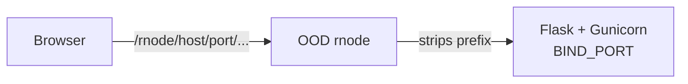

# Deploying Multi-Dimensional Viewer (MDV) via OpenOnDemand

<p align="center">

</p>

[Multi-Dimensional Viewer (MDV)](https://mdv.molbiol.ox.ac.uk/) is a tool for analyzing, annotating and sharing multi-dimensional data. 

This repository packages MDV as an OpenOnDemand interactive app. MDV runs inside an
Apptainer container on a compute node, with OOD's `rnode` proxy talking straight to
Gunicorn. Developed and in production on the BMRC cluster
at the University of Oxford, and intended to be portable to other OOD sites. For MDV
itself, see the [upstream project](https://github.com/Taylor-CCB-Group/MDV).


# License & Attribution

The MIT license in this repository applies solely to the deployment scripts, configuration files, and documentation 
provided here for running MDV (https://mdv.ndm.ox.ac.uk/) via OpenOnDemand. 
MDV itself is not covered by this license. 

All intellectual property rights for MDV remain with the original authors. Please refer to the [original license](https://github.com/Taylor-CCB-Group/MDV/blob/main/LICENSE) 
before using, modifying, or redistributing MDV.

## How a session starts



On the compute node, inside one Apptainer container:

| Component          | Notes                                                    |
| ------------------ | -------------------------------------------------------- |
| Flask + Gunicorn   | `gevent` worker, serves the app and API                  |
| Vite frontend      | Built at image time into `/app/dist`                     |
| PostgreSQL         | Initialised per session, not a sidecar                   |
| Projects directory | On GPFS, supplied by the user — persists across sessions |

The database is an index rebuilt from the projects directory at startup. The projects
directory is the only thing that has to survive.

## Version handling

The container path lives in an Lmod module, not in the app config. The form offers a
version dropdown; the chosen module is loaded at launch and exports `MDV_SIF`.

```lua
-- MDV/main.lua
local version = "main"
local sif = "/apps/.../MDV/mdv-" .. version .. ".sif"

setenv("MDV_SIF",     sif)
setenv("MDV_VERSION", version)
```

```bash
# template/script.sh.erb
module load <%= context.mdv_module %>
apptainer run ... "${MDV_SIF}"
```

**To add a version:** build a SIF, drop in a `.lua`, add one line to the form dropdown.
Nothing in the launch script changes.

## Serving MDV behind `rnode`

OpenOnDemand's reverse proxy (`rnode`) serves the app at `/rnode/<hostname>/<port>/` and
strips that prefix before forwarding, so MDV always sees requests at its own root. Two
things make that work without a proxy of our own:

- **MDV's pages load assets by relative path** (`../` once per level of the page's path,
  so a project page at `/project/1/` still reaches `/flask/assets/...`). This needs a SIF
  built from MDV at or after Taylor-CCB-Group/MDV#571 (20 October 2026); older builds
  used absolute `/flask/` paths, which only worked through the old `proxy.py` rewrite.
- **`MDV_API_ROOT` is set to `/rnode/<hostname>/<port>/`.** MDV hands this prefix to the
  browser for API and socket.io URLs, and uses it for the redirect after login and, when
  auth is on, as the session cookie path.

Gunicorn listens on the port OOD picked (`BIND_PORT`), and `after.sh` waits until it
answers over HTTP before OOD shows the Connect button. socket.io's WebSocket traffic
goes through `rnode` directly.

<details>
<summary>Why there used to be a <code>proxy.py</code></summary>

Earlier MDV builds referenced assets as `/flask/...`, which the browser resolves against
the OOD server root rather than through `rnode`. `proxy.py` sat on `BIND_PORT`, forwarded
to Gunicorn on `BIND_PORT + 1`, and rewrote those paths in HTML. It was removed because:

1. Its `ThreadingHTTPServer` kept Python's default listen queue of 5. A page load fetches
   hundreds of JS/CSS chunks at once, and connections beyond the queue were dropped;
   Apache turned them into "502 Proxy Error" pages, which the browser reported as
   "Failed to fetch dynamically imported module" or "Unexpected token '<'"
   ([#36](https://github.com/kir-rescomp/ood-app-mdv/issues/36)).
2. `BIND_PORT + 1` was never checked for being free, so a session could start Gunicorn
   on a port another session already held.
3. Once MDV moved to relative asset paths, the rewrite no longer matched anything.

</details>

## Runtime data

MDV's internal data — the PostgreSQL cluster, logs and caches — lives in a per-session
directory on **node-local `/tmp`**, keyed by the OOD session ID. Cleanup is via a `trap`
on exit, with a stale-directory sweep as a backstop.

The form asks only for the project directory, matching standard MDV startup.

<details>
<summary>Why not a user-supplied data directory?</summary>


An earlier version had a second form field for a BMRC path. Three problems:

1. **Shared paths collide.** Two sessions pointed at one data directory clash on the
   PostgreSQL data directory and port 5432.
2. **Group-write is not inherited.** On shared directories, group-write permissions
   aren't inherited by default — sharing a directory meant manual checking each time.
3. **Divergence from upstream.** Standard MDV startup asks only for the project
   directory.

</details>


> [!IMPORTANT]
> Caches are rebuilt each session, so expect a ~90 s numba recompile on first launch.
> This is the trade-off for the `/tmp` move, not a bug. Projects persist regardless — the
> database is rebuilt from the projects directory.


## Container gotchas

Relevant when rebuilding the SIF from the upstream Dockerfile.

**Apptainer has no build stages.** Multi-stage Docker builds have to be flattened; the
whole build runs sequentially in `%post`.

**PostgreSQL over TCP, not a Unix socket.** MDV constructs a `postgresql://host/db` URL,
so a socket path won't fit.

**`/var/run` is read-only.** Redirect the PostgreSQL lock file to writable space.

